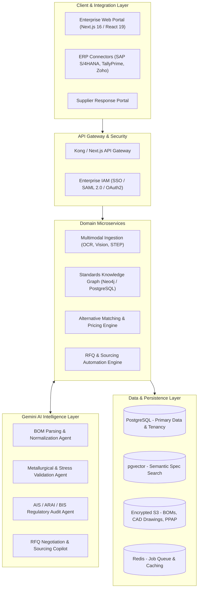

# SEION AutoPart AI — Enterprise Documentation Hub

Welcome to the central documentation hub for **SEION AutoPart AI**, an enterprise-grade AI-powered Bill of Materials (BOM) cost intelligence, standards cross-referencing, and procurement platform built specifically for automotive Tier-1, Tier-2, and Tier-3 suppliers.

---

## 🎯 Platform Mission

In the automotive manufacturing sector, Tier-2 suppliers routinely receive Bills of Materials (BOMs) from global OEMs specifying foreign-standard components (e.g., German DIN, ISO, American ASTM/SAE, Japanese JIS). Sourcing or importing these exact parts into India leads to inflated component costs, severe customs delays, single-source dependency risks, and compressed margins.

**SEION AutoPart AI transforms this workflow by:**
1. Ingesting raw, unstructured engineering BOMs (PDFs, engineering drawings, Excel spreadsheets, and 3D CAD/STEP files).
2. Automatically cross-referencing foreign specifications against certified, equivalent **Indian Standards (IS)** meeting **BIS** and **ARAI / AIS** requirements.
3. Conducting instant, automated metallurgical and mechanical validation using specialized AI agents.
4. Directly generating and dispatching compliance-ready Requests for Quotation (RFQs) to verified domestic manufacturing clusters (Chennai, Pune, Manesar, Coimbatore).

---

## 📚 Documentation Index

This directory provides comprehensive enterprise documentation across technical architecture, business strategy, domain ontology, APIs, and roadmap:

| Document | Primary Audience | Description |
| :--- | :--- | :--- |
| [**Product Strategy & Value Propositions**](./product-strategy.md) | Leadership, Product, Sales | Market analysis, Ideal Customer Profile (ICP), core value propositions, unit economics, ROI calculators, and monetization models. |
| [**Enterprise System Architecture**](./architecture.md) | Architects, DevOps, Engineers | System component topology, C4 architectural diagrams, multimodal ingestion pipeline, Gemini AI multi-agent orchestration, and enterprise security/governance (SOC 2, ISO 27001). |
| [**Standards Ontology & Domain Model**](./standards-and-domain-model.md) | Domain Experts, Backend Engineers | Comprehensive mapping matrix between DIN/ISO and Indian Standards (IS/ARAI/AIS), material property databases, entity-relationship schemas, and PPAP compliance checklists. |
| [**Enterprise API Specification**](./api-specification.md) | Integrators, Solution Engineers | RESTful and asynchronous API endpoints, webhook event catalog, ERP integration guides (SAP S/4HANA, TallyPrime, Zoho Books), and authentication standards. |
| [**Enterprise Roadmap & Implementation**](./enterprise-roadmap.md) | Product Managers, Engineering Leads | 4-Phase execution blueprint moving from the current MVP to a production enterprise platform with milestones, deliverables, and technical debt remediation. |

---

## 🏗️ High-Level System Architecture at a Glance

---

## ⚡ Quick Technical Overview

- **Frontend Application**: Next.js 16 (App Router), React 19, TypeScript, Tailwind CSS v4, Radix UI primitives.
- **AI Intelligence**: Google Gemini 2.0 Flash (`gemini-2.0-flash`) for sub-second multimodal document extraction and metallurgical validation reasoning.
- **Data Target**: PostgreSQL with Row-Level Security (RLS) for multi-tenant data isolation, coupled with `pgvector` for semantic similarity search on technical specifications.
- **Compliance Alignment**: Bureau of Indian Standards (BIS), Automotive Research Association of India (ARAI), Automotive Industry Standards (AIS), and IATF 16949 quality management requirements.

---

## 🛡️ Enterprise Security & IP Protection Note

Automotive BOMs and engineering drawings represent core intellectual property for OEMs and tier suppliers. SEION AutoPart AI is engineered with zero-data-retention AI processing principles, customer-isolated encryption keys (BYOK), and tenant-level data airgapping. For details, refer to [Enterprise Security & Governance in Architecture](./architecture.md#security-compliance--enterprise-governance).
