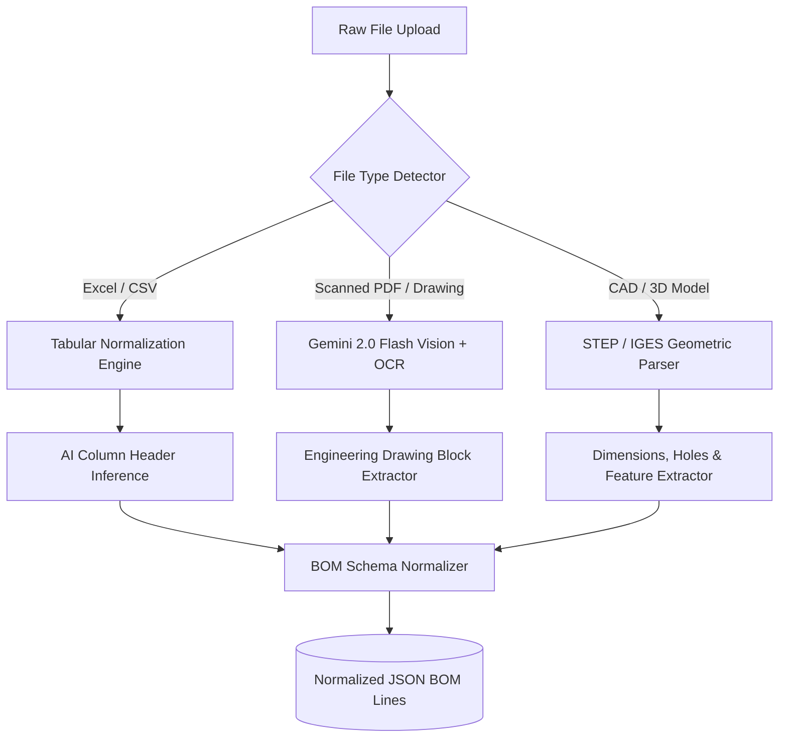
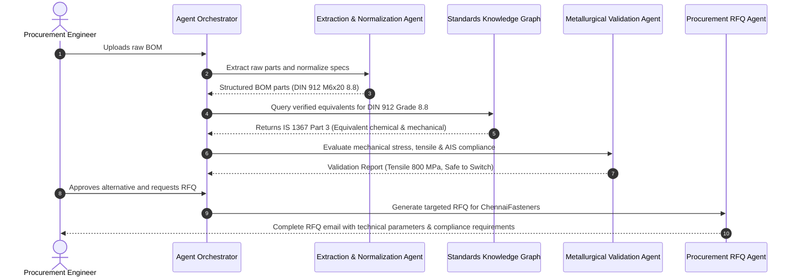

# Enterprise System Architecture — SEION AutoPart AI

---

## 1. Architectural Philosophy & Principles

To support automotive manufacturing enterprises, SEION AutoPart AI is architected around five core principles:

1. **Deterministic Accuracy Over Pure Generative Prediction**: While Generative AI (Gemini 2.0) is utilized for unstructured text extraction and synthesis, engineering decisions (metallurgical properties, tensile strength, thread pitch, dimensional tolerance) must be validated against a deterministic, verified **Standards Knowledge Graph**.
2. **Zero Intellectual Property Leakage**: OEM engineering drawings, CAD files, and BOM configurations are confidential trade secrets. The architecture enforces zero-training API agreements with model providers, temporary ephemeral file processing, and customer-isolated data storage.
3. **Sub-Second Real-Time Interactivity with Async Batch Resilience**: Small BOMs (under 100 parts) execute synchronously via streaming APIs; large assembly BOMs (thousands of parts, nested sub-assemblies) are processed through durable asynchronous job queues.
4. **Air-Gapped Multi-Tenancy**: Data between competing Tier-2 suppliers (and even between distinct OEM programs within the same supplier) is cryptographically isolated using PostgreSQL Row-Level Security (RLS) and tenant-specific encryption keys.

---

## 2. System Topology (C4 Container Diagram)

```mermaid
C4Container
    title Container Diagram for SEION AutoPart AI Enterprise Platform

    Person(procurement_eng, "Procurement / VAVE Engineer", "Tier-2 Sourcing Engineer seeking cost-optimized domestic alternatives")
    Person(supplier_rep, "Domestic Supplier", "Component manufacturer receiving and responding to RFQs")

    System_Boundary(seion_system, "SEION AutoPart AI Platform") {
        Container(web_app, "Enterprise Web Application", "Next.js 16, React 19, Tailwind CSS", "Provides BOM upload, interactive comparison, 3D visualization, and RFQ dashboard")
        Container(api_gateway, "API Gateway / Route Handlers", "Next.js Server Actions & Route Handlers / Kong", "Handles auth, rate limiting, tenant context injection, and payload validation")
        
        Container(ingestion_service, "BOM Ingestion Engine", "Python / FastAPI / Node.js", "Parses PDFs, Excel, CSV, and STEP/CAD geometry files")
        Container(matching_engine, "Standards & Sourcing Engine", "TypeScript / Go", "Executes graph traversals to identify domestic standard equivalents")
        Container(agent_orchestrator, "Gemini Multi-Agent Orchestrator", "Google GenAI SDK (gemini-2.0-flash)", "Orchestrates extraction, metallurgical validation, and RFQ generation agents")
        
        ContainerDb(primary_db, "Enterprise Relational DB", "PostgreSQL 16 + RLS", "Stores tenants, users, BOMs, items, and audit logs")
        ContainerDb(standards_graph, "Standards Knowledge Graph", "PostgreSQL / Neo4j", "Maintains ontological relations between DIN, ISO, IS, and AIS standards")
        ContainerDb(vector_db, "Semantic Vector Store", "pgvector", "Embeds component descriptions for fuzzy matching against supplier catalogs")
        ContainerDb(cache_queue, "Job Queue & Cache", "Redis / BullMQ", "Drives asynchronous file processing and distributes background jobs")
        ContainerDb(blob_storage, "Encrypted Object Storage", "AWS S3 / Azure Blob", "Stores uploaded drawings, CAD files, and generated PDF reports")
    }

    System_Ext(erp_system, "Customer ERP System", "SAP S/4HANA, TallyPrime, Zoho Books")
    System_Ext(gemini_api, "Google Gemini AI Platform", "gemini-2.0-flash endpoint")

    Rel(procurement_eng, web_app, "Uploads BOMs, inspects alternatives, triggers RFQs", "HTTPS / WSS")
    Rel(supplier_rep, web_app, "Submits quotations and test certs", "HTTPS")
    Rel(web_app, api_gateway, "Calls authenticated endpoints", "JSON / HTTPS")
    Rel(api_gateway, ingestion_service, "Dispatches file processing jobs", "gRPC / BullMQ")
    Rel(api_gateway, matching_engine, "Queries alternatives", "gRPC / REST")
    Rel(matching_engine, standards_graph, "Traverses equivalent specs", "SQL / Cypher")
    Rel(matching_engine, vector_db, "Performs semantic catalog lookup", "SQL / pgvector")
    Rel(agent_orchestrator, gemini_api, "Executes domain agent prompts", "REST / TLS 1.3")
    Rel(api_gateway, erp_system, "Syncs approved BOMs and purchase reqs", "OData / REST")
    Rel(ingestion_service, blob_storage, "Stores raw and processed files", "S3 API")
```



---

## 3. Multimodal Ingestion Pipeline

BOM files in automotive environments arrive in disparate, highly inconsistent formats. The ingestion pipeline handles four distinct input modalities:



### 1. Tabular Parser (Excel / CSV)
- Ingests `.xlsx`, `.xls`, `.csv`, `.tsv` files.
- Uses semantic embedding to automatically map messy columns (e.g., `"Part Description"`, `"Matl."`, `"Qty Req."`, `"OEM P/N"`, `"Finish"`) to a standard internal schema.

### 2. Engineering Drawings & PDF Ingestion (Vision + OCR)
- Processes multi-page engineering drawing title blocks, notes, and revision tables.
- Leverages **Gemini 2.0 Flash** multimodal vision to read engineering annotations, tolerance tables (e.g., `ISO 2768-m`), material callouts (e.g., `DIN EN 10083-3 42CrMo4`), and surface treatment specs.

### 3. STEP / 3D CAD Geometry Parser
- Ingests ISO 10303 STEP (`.stp`, `.step`) and IGES files.
- Computes bounding box dimensions, volume, mass estimates (based on assigned steel density), detects standard hole diameters (identifying M6, M8, M10 tapped holes), and categorizes parts into standard fasteners, turned pins, or stamped sheet metal.

---

## 4. Multi-Agent Orchestration Architecture

Rather than relying on a single monolithic prompt, SEION AutoPart AI employs an orchestrated ensemble of specialized AI agents:



### Agent Roles & Configurations:
1. **Extraction Agent**:
   - Model: `gemini-2.0-flash`
   - Role: Fast token extraction, noise filtering, and JSON schema conformity.
   - Temperature: `0.1` (deterministic).
2. **Metallurgical Validation Agent**:
   - Model: `gemini-2.0-flash` (or `gemini-1.5-pro` for deep reasoning)
   - Role: Compares carbon equivalent (CE), yield strength ($R_{p0.2}$), tensile strength ($R_m$), elongation ($A_5$), and coating salt spray resistance (ASTM B117 vs. IS 9844).
   - Temperature: `0.2`.
3. **Procurement & RFQ Copilot Agent**:
   - Model: `gemini-2.0-flash`
   - Role: Synthesizes commercial requirements, volume discounts, packaging specifications (VCI paper, export pallets), and payment terms into standard enterprise RFQs.
   - Temperature: `0.5`.

---

## 5. Security, Compliance & Enterprise Governance

### Immediate Vulnerability Remediation in Current Codebase
In the current prototype, [`lib/gemini.ts`](file:///c:/Users/acer/Documents/GitHub/AUTOPART_AI/lib/gemini.ts#L2) accesses the Gemini API key using `process.env.NEXT_PUBLIC_GEMINI_API_KEY`, exposing the secret in the client's browser bundle. 

**Enterprise Target Architecture**:
- Migrate all AI and database interactions to **Next.js Server Actions** or Route Handlers (`app/api/v1/gemini/route.ts`).
- Secure API keys using AWS Secrets Manager or HashiCorp Vault.
- Client browsers receive only signed session tokens; raw API credentials are never sent to client devices.

```
Client Browser (React 19) 
      │
      ▼ (HTTPS + HttpOnly Secure Cookie / JWT)
Next.js Route Handler / Server Action (Node.js Server)
      │
      ▼ (Encrypted internal VPC call with server-side GEMINI_API_KEY)
Google Gemini Enterprise API Endpoint
```

### Enterprise Security Controls:
1. **Data Confidentiality & Zero-Training Guarantee**:
   - Enterprise agreements with Google Cloud Vertex AI / Gemini ensure that customer data, BOM line items, and uploaded CAD files are **never used to train base foundation models**.
2. **Multi-Tenancy via PostgreSQL Row-Level Security (RLS)**:
   - Every database table enforces `tenant_id` scoping.
   - Database connections set `app.current_tenant_id = '<user_tenant_uuid>'` on each transaction, guaranteeing physical impossibility of cross-tenant data leakage.
3. **Encryption at Rest and in Transit**:
   - TLS 1.3 enforced for all client and internal service communication.
   - Storage buckets and database volumes encrypted with AES-256 (KMS with customer-managed keys / BYOK option).
4. **Audit Logging & Compliance**:
   - Immutable audit log table recording every BOM upload, viewing, alternative selection, and export with user timestamp, IP address, and cryptographic checksum.
   - Supports compliance with **IATF 16949 Section 7.5** (Documented Information Control) and **ISO 27001**.
