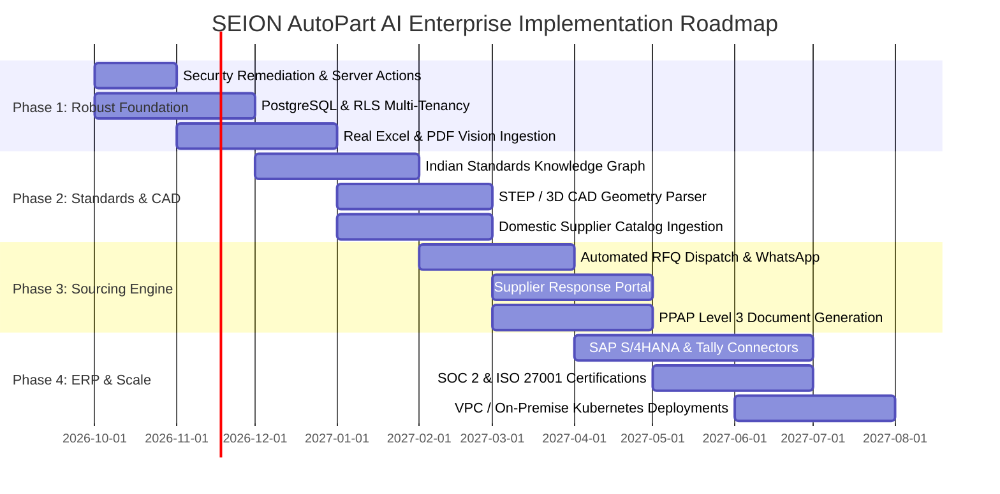

# Enterprise Roadmap & Execution Strategy — SEION AutoPart AI

---

## 1. Roadmap Overview & Phased Maturity Model

Transforming SEION AutoPart AI from an interactive design prototype into a mission-critical enterprise software platform requires a structured 12-month phased roadmap. Each phase delivers measurable commercial value, expanding from initial data security and accurate ingestion to deep ERP integrations and automated supplier marketplaces.

---

## Phase 1: Robust Foundation & Security Hardening (Months 1 – 3)

### Objective
Eliminate prototype vulnerabilities, introduce persistent database storage, and establish genuine multimodal file ingestion.

### Key Deliverables:
1. **API Key Security & Backend Migration**:
   - Refactor [`lib/gemini.ts`](file:///c:/Users/acer/Documents/GitHub/AUTOPART_AI/lib/gemini.ts) to remove `NEXT_PUBLIC_GEMINI_API_KEY`.
   - Implement Next.js Server Actions and Route Handlers (`app/api/v1/gemini/route.ts`) executing with secure server-side credentials.
2. **Persistent Relational Database (PostgreSQL + Prisma / Drizzle ORM)**:
   - Deploy PostgreSQL with Row-Level Security (RLS) enforcing tenant separation.
   - Implement database migrations for `tenants`, `users`, `boms`, `bom_items`, `part_alternatives`, and `technical_validations`.
3. **True File Ingestion Engine**:
   - **Excel / CSV Parser**: Replace mock upload with an streaming Excel parser using `xlsx` / `exceljs`, featuring auto-mapping of non-standard column headers.
   - **PDF Document OCR & Vision**: Implement Gemini 2.0 Flash Multimodal Vision pipeline to ingest scanned drawings and multi-page BOM PDFs.
4. **Authentication & Role-Based Access Control (RBAC)**:
   - Integrate enterprise identity provider (Supabase Auth / NextAuth / WorkOS) supporting Google Workspace, Microsoft Entra ID (Azure AD), and SAML 2.0 SSO.
   - Introduce user roles: `Procurement Engineer`, `Quality Manager`, `Plant Admin`, and `Auditor`.

---

## Phase 2: Standards Knowledge Graph & 3D CAD Ingestion (Months 4 – 6)

### Objective
Establish the proprietary technological moat: deep automotive standards cross-referencing and 3D geometric validation.

### Key Deliverables:
1. **Curated Indian Automotive Standards Knowledge Graph**:
   - Digitize and index complete dimensional, mechanical, and coating specifications across 500+ Indian Standards (**IS 1367, IS 1364, IS 2016, IS 5517, IS 513, IS 2062, IS 5593**).
   - Implement graph relationships mapping DIN, ISO, ASTM, and JIS equivalents with hardness, tensile, and shear boundary checks.
2. **3D STEP / CAD Geometric Parser & Viewer**:
   - Ingest ISO 10303 STEP (`.stp`, `.step`) and IGES files.
   - Integrate a WebGL / Three.js 3D interactive viewer in [`components/results-view.tsx`](file:///c:/Users/acer/Documents/GitHub/AUTOPART_AI/components/results-view.tsx) allowing engineers to visually inspect cross-sections and verify dimensional parity.
3. **Domestic Supplier Database (Phase 1 Catalog)**:
   - Onboard structured supplier catalogs from over 250 verified component manufacturers across major Indian automotive hubs (Chennai, Pune, Manesar, Rajkot, Coimbatore).
   - Index suppliers by machine tonnage, IATF 16949 certification status, and historical delivery lead times.

---

## Phase 3: Sourcing Automation & Supplier Response Portal (Months 7 – 9)

### Objective
Close the procurement loop by automating quote requests, supplier communications, and quality documentation.

### Key Deliverables:
1. **Multi-Channel RFQ Dispatch Engine**:
   - Automate email dispatch using Amazon SES / SendGrid with customized, professional RFQ PDF attachments.
   - Integrate WhatsApp Business API for instant supplier alerts and fast quotation submissions.
2. **Supplier Response Portal (Zero-Friction Bidding)**:
   - Provide suppliers with secure, authenticated magic links to review requested part quantities, input unit pricing, confirm stock availability, and upload Mill Test Reports (MTR) without creating an account.
3. **Automated Bid Evaluation Matrix**:
   - Aggregate incoming vendor quotes into a real-time comparison table in [`components/results-view.tsx`](file:///c:/Users/acer/Documents/GitHub/AUTOPART_AI/components/results-view.tsx), highlighting optimal landed cost, lead time, and compliance risk.
4. **Automated PPAP Documentation Builder**:
   - Generate AIAG-compliant Part Submission Warrants (PSW) and technical delta risk sheets for quality manager sign-off.

---

## Phase 4: Enterprise ERP Connectors & Compliance Scale (Months 10 – 12)

### Objective
Embed SEION directly into Tier-1/Tier-2 enterprise operating systems and secure defense/aerospace compliance certifications.

### Key Deliverables:
1. **Bi-Directional ERP Integrations**:
   - **SAP S/4HANA**: Certified OData connectors to push approved optimized BOM line items directly into SAP Purchase Requisitions (`ME51N`).
   - **TallyPrime & Zoho Books**: Native XML and REST connectors for mid-sized Indian Tier-2/Tier-3 machine shops.
2. **Enterprise Governance & Security Certifications**:
   - Achieve **SOC 2 Type II** compliance and **ISO/IEC 27001** certification.
   - Enforce compliance with automotive industry standard **TISAX** (Trusted Information Security Assessment Exchange) for German OEM interoperability.
3. **Containerized VPC & On-Premise Deployment Option**:
   - Package the full platform as a Helm chart for deployment on customer-managed Kubernetes clusters (AWS EKS, Azure AKS, or bare-metal on-premise servers for defense subcontractors).
   - Support private LLM inference via Google Cloud Vertex AI dedicated endpoints or on-premise open-weights models.

---

## 2. Technical Debt Remediation in Existing Prototype

To support this roadmap, the following technical refactors should be prioritized in upcoming development sprints:

| Component | Current State | Target Enterprise Implementation | Priority |
| :--- | :--- | :--- | :---: |
| [`lib/gemini.ts`](file:///c:/Users/acer/Documents/GitHub/AUTOPART_AI/lib/gemini.ts#L2) | Client-side API key access (`NEXT_PUBLIC_`) | Next.js Server Actions / Server-side Route Handler | 🔴 P0 (Critical) |
| [`components/dashboard-view.tsx`](file:///c:/Users/acer/Documents/GitHub/AUTOPART_AI/components/dashboard-view.tsx#L24-L30) | Mock `setTimeout(3000)` on drop zone | Real multipart upload to `/api/v1/boms/upload` with S3 storage | 🔴 P0 (Critical) |
| [`components/results-view.tsx`](file:///c:/Users/acer/Documents/GitHub/AUTOPART_AI/components/results-view.tsx#L8-L59) | Static hardcoded `MOCK_BOM_PARTS` array | Dynamic state populated from PostgreSQL API response | 🔴 P0 (Critical) |
| [`components/lucide-icon.tsx`](file:///c:/Users/acer/Documents/GitHub/AUTOPART_AI/components/lucide-icon.tsx) | Handcrafted SVG paths for 16 icons | Replace with direct imports from `@lucide/react` | 🟡 P1 (Medium) |
| [`components/results-view.tsx`](file:///c:/Users/acer/Documents/GitHub/AUTOPART_AI/components/results-view.tsx#L265-L270) | Decorative "Export PDF" button | Real PDF generation using `@react-pdf/renderer` or Puppeteer | 🟡 P1 (Medium) |
| [`app/page.tsx`](file:///c:/Users/acer/Documents/GitHub/AUTOPART_AI/app/page.tsx#L10-L54) | Monolithic view switcher in React state | Proper Next.js URL routing (`/`, `/dashboard`, `/boms/[id]`) | 🟡 P1 (Medium) |
