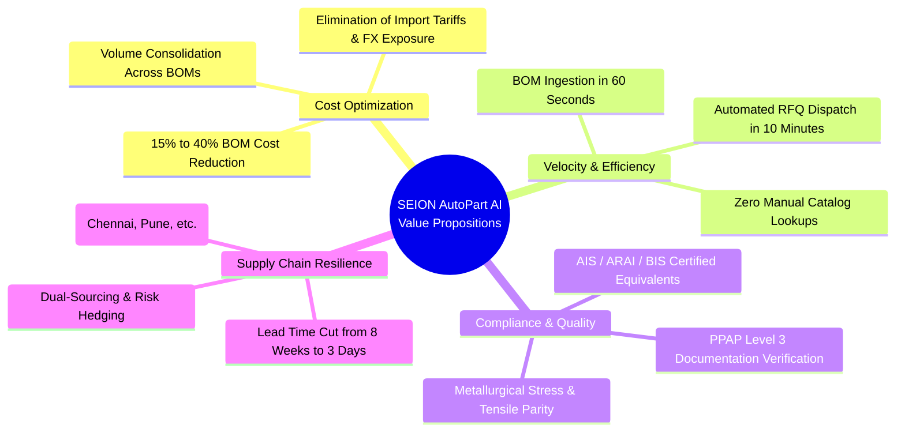
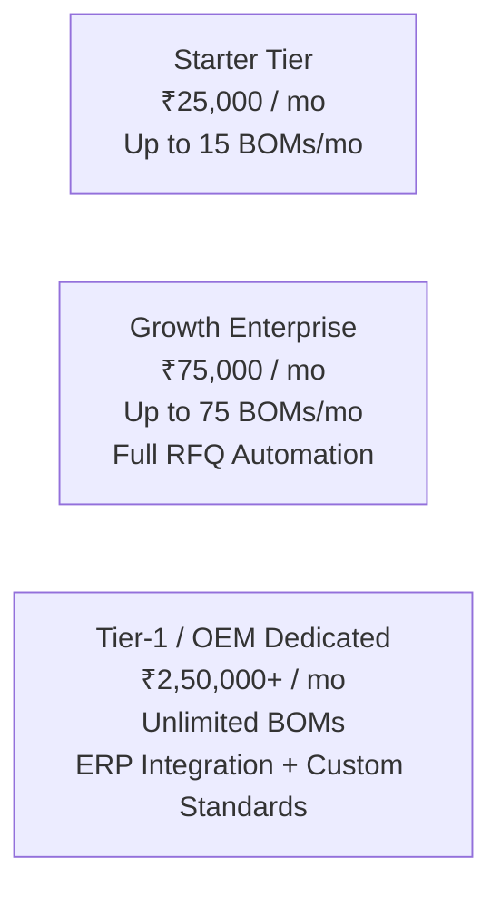

# Product Strategy & Value Propositions — SEION AutoPart AI

> **Read [market-research.md](./market-research.md) first.** This document is an early pitch draft. Its savings, ROI, payback and market-size figures are **not validated** by customer data or current public sources. The market research corrects them and recommends repositioning around BIS / IS compliance and localization.

---

## 1. Executive Summary & Market Landscape

The Indian automotive component industry is an estimated **$60B+ market**, driven by rapid electrification, surging domestic vehicle production, and global supply chain re-alignment ("China + 1" strategy). The Government of India’s **Production Linked Incentive (PLI)** scheme for automobile and auto components, combined with stringent **Phased Manufacturing Programme (PMP)** requirements, mandates domestic value addition of up to 50–70% for Tier-1 and Tier-2 manufacturers.

Despite this push for localization, **over 65% of Tier-2 and Tier-3 suppliers** struggle with:
1. **Foreign Specification Traps**: Engineering BOMs cascaded down from global OEMs (e.g., German, Japanese, American platforms) mandate components designated under foreign standards (**DIN, ISO, JIS, ASTM, SAE**).
2. **Expensive Procurement Overhead**: Tier-2 procurement engineers spend days manually cross-referencing catalogs, calling distributors, and verifying whether an Indian Standard (**IS**) component meets OEM tensile, shear, and dimensional tolerances.
3. **Margin Erosion**: Procuring imported fasteners, specialized seals, or cold-forged brackets incurs high unit costs, ocean freight surcharges, import tariffs, and volatile currency exchange rates.

**SEION AutoPart AI** delivers an enterprise-grade AI intelligence platform that ingests raw OEM BOMs, unlocks direct domestic standard equivalents with guaranteed metallurgical compliance, and automates supplier RFQ generation—compressing a multi-week engineering sourcing cycle into under 15 minutes.

---

## 2. Ideal Customer Profile (ICP)

SEION AutoPart AI targets three primary enterprise buyer segments:

### Segment A: Tier-2 Automotive Sub-Assembly Manufacturers (Core ICP)
- **Profile**: Companies manufacturing sub-assemblies (engine mounts, transmission linkages, suspension brackets, brake caliper housings, steering columns).
- **Annual Turnover**: ₹25 Cr to ₹500 Cr ($3M – $60M USD).
- **Geography**: Major Indian automotive clusters (Chennai-Sriperumbudur, Pune-Chakan-Talegaon, Manesar-Gurugram-Faridabad, Ahmedabad-Sanand, Coimbatore).
- **Key Decision Makers**: Head of Procurement / Sourcing, Chief Operating Officer (COO), VP of Quality & Engineering.
- **Pain Point**: Tight fixed-price contracts with Tier-1s/OEMs; rising raw material costs squeezing operating margins to under 6–8%.

### Segment B: Tier-1 Sourcing & VAVE (Value Analysis / Value Engineering) Teams
- **Profile**: Multi-plant global Tier-1 suppliers (e.g., Motherson, Bharat Forge, Uno Minda, Endurance, Sona Comstar).
- **Focus**: Dedicated localization teams tasked with removing imported parts from global vehicle platforms being adapted for the Indian market.
- **Key Decision Makers**: Head of VAVE, Global Sourcing Director, Localization Engineering Lead.
- **Pain Point**: Lack of automated tooling to map thousands of complex legacy foreign drawings to certified domestic suppliers.

### Segment C: Precision Engineering Job Shops & Defense/Aerospace Subcontractors
- **Profile**: High-mix, medium-volume precision machining and fabrication facilities responding to foreign OEM contract tenders.
- **Key Decision Makers**: Managing Director, Estimations Head.
- **Pain Point**: Lengthy quotation estimation times (often taking 2–3 weeks just to quote a BOM), resulting in lost bidding opportunities.

---

## 3. Core Enterprise Value Propositions

### Value Prop 1: Direct 15% to 40% BOM Cost Reduction
- **Mechanism**: Automatically identifies over-specified foreign commodity parts (fasteners, standard O-rings, stamped washers, generic structural tubing) and identifies certified domestic equivalents.
- **Impact**: On a typical ₹5,00,000 monthly BOM spend for fasteners and standard mechanical consumables, switching to IS standards yields **₹1,00,000 to ₹1,80,000 in direct monthly net savings** per production line.

### Value Prop 2: 95% Reduction in Sourcing Turnaround Time
- **Mechanism**: Eliminates manual PDF reading, phone calls to distributors, and back-and-forth email negotiations. Raw multi-page PDF engineering drawings or messy Excel files are parsed and mapped to active domestic supplier parts within 60 seconds.
- **Impact**: Reduces engineering estimation and quotation turnaround from **14 business days down to under 15 minutes**.

### Value Prop 3: Defensible Metallurgical & Regulatory Compliance
- **Mechanism**: Automotive applications do not permit guesswork. The integrated Gemini AI Metallurgical Agent validates chemical composition, tensile strength (yield, elongation), hardness (HRC/HRB), and coating performance against **AIS-071** and **BIS** specifications.
- **Impact**: Procurement and quality teams receive an audit-ready **Technical Validation Report** confirming that structural integrity and failure modes match OEM specifications.

### Value Prop 4: Supply Chain De-Risking & Localization
- **Mechanism**: Eliminates single-source dependencies on overseas distributors. Connects buyers with pre-qualified domestic suppliers possessing ISO 9001 / IATF 16949 certifications.
- **Impact**: Reduces lead times from **6–10 weeks (sea freight + customs)** to **48–72 hours (domestic logistics)**.

---

## 4. ROI Financial Model & Unit Economics

### Representative Case Study: Mid-Sized Tier-2 Chassis Component Manufacturer

| Metric | Before SEION AutoPart AI | With SEION AutoPart AI | Financial Impact |
| :--- | :--- | :--- | :--- |
| **Monthly BOM Spend (Commodity Parts)** | ₹12,50,000 (Imported DIN/ISO parts) | ₹8,40,000 (Certified IS alternatives) | **₹4,10,000 direct monthly savings (32.8%)** |
| **Procurement Cycle Time per BOM** | 12 business days | 25 minutes | **98% reduction in engineering hours** |
| **Procurement Engineer Overhead** | 2 dedicated engineers per plant | 0.5 engineer equivalent | **₹90,000/month in engineering capacity freed up** |
| **Average Component Lead Time** | 42 days (Overseas shipping) | 4 days (Local cluster delivery) | **90% reduction in working capital locked in inventory** |
| **Inventory Holding Cost** | ₹18,00,000 buffer stock | ₹4,50,000 safety stock | **₹13,50,000 working capital released** |

### Annual Net ROI Calculation
- **Annual Direct Component Savings**: ₹4,10,000 × 12 = **₹49,20,000 ($59,000 USD)**
- **Annual Enterprise Platform Cost (Estimated)**: ₹6,00,000 ($7,200 USD)
- **First-Year Net ROI**: **820%**
- **Payback Period**: **14 calendar days**

---

## 5. Competitive Landscape & Strategic Moats

| Capability | Generic LLMs (ChatGPT, Claude) | Legacy ERPs (SAP, Tally) | Engineering CAD Tools | SEION AutoPart AI |
| :--- | :---: | :---: | :---: | :---: |
| **Automotive Standards Knowledge Graph** | ❌ Hallucinates specs | ❌ No standards data | ❌ Dimensions only | **✅ Deep DIN/IS/ISO/ARAI ontology** |
| **BOM Ingestion (PDF / Excel / CAD)** | ⚠️ Unstructured text only | ❌ Rigid template required | ⚠️ CAD only | **✅ Multimodal (PDF, XLSX, STEP, CSV)** |
| **Metallurgical & Compliance Audit** | ⚠️ Generic advice | ❌ None | ⚠️ Simulation only | **✅ AIS-071 & BIS engineering checks** |
| **Domestic Supplier & Price Database** | ❌ No real-time data | ⚠️ Internal history only | ❌ None | **✅ Live Indian industrial cluster data** |
| **Automated RFQ Dispatch & Sourcing** | ❌ None | ⚠️ Static purchase orders | ❌ None | **✅ 1-Click RFQ + vendor comparison** |

### Defensible Moats
1. **Proprietary Standards Equivalence Knowledge Graph**: A specialized relational and graph taxonomy mapping thousands of international automotive specifications to Indian Standards with verified tolerances, hardness equivalents, and heat treatment certifications.
2. **Indian Supplier Sourcing Intelligence**: Proprietary database of qualified Tier-2/Tier-3 suppliers indexed by machine capacity, certifications (IATF 16949, ISO 9001), geographic hubs, and verified lead times.
3. **Closed-Loop Procurement Data**: Machine learning feedback loops that continuously refine price estimation models based on completed RFQs and historical supplier quotes.

---

## 6. Commercialization & Monetization Models

SEION AutoPart AI employs an enterprise SaaS subscription model supplemented by volume-based usage tiers:

1. **Starter Tier (Mid-sized Job Shops & Tier-3s)**:
   - ₹25,000/month ($300/mo).
   - Ingest up to 15 BOMs/month (max 250 line items each).
   - Core standards cross-referencing and technical validation reports.
2. **Growth Enterprise (Tier-2 Production Plants)**:
   - ₹75,000/month ($900/mo).
   - Up to 75 BOMs/month.
   - Multimodal STEP/CAD geometry inspection.
   - Automated RFQ dispatch and supplier quotation portal.
   - Multi-user RBAC for Procurement, Quality, and Operations teams.
3. **Tier-1 / OEM Dedicated (Enterprise & VAVE Teams)**:
   - Custom annual contract starting at ₹25,00,000/year ($30,000/yr).
   - Unlimited BOM processing.
   - Dedicated private tenant (VPC / On-Premise option).
   - Bi-directional ERP integration (SAP S/4HANA, TallyPrime, Microsoft Dynamics).
   - Custom proprietary OEM part code mapping and private supplier networks.
