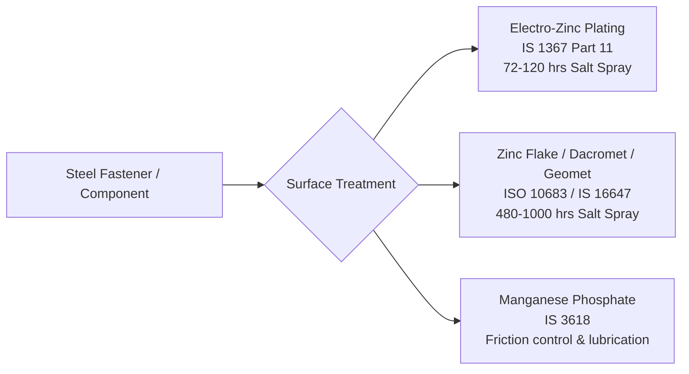
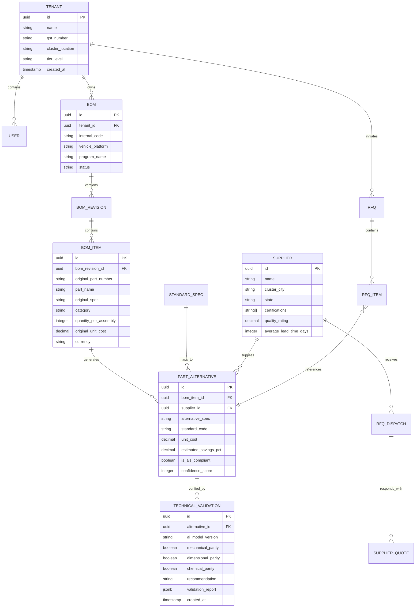
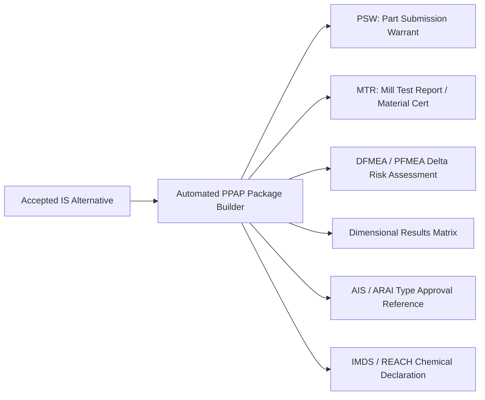

# Automotive Standards & Domain Data Model — SEION AutoPart AI

---

## 1. Automotive Standards Cross-Reference Taxonomy

Automotive engineering relies on precise international and regional standardization bodies. A core defensible asset of SEION AutoPart AI is its curated **Standards Equivalence Matrix**, which systematically bridges European (DIN), Global (ISO), American (ASTM/SAE), and Japanese (JIS) specifications to Indian Standards (**IS**) certified by the **Bureau of Indian Standards (BIS)** and authorized under **Automotive Industry Standards (AIS)**.

### Fasteners & Hardware Equivalence Matrix

| Part Type | German Standard (DIN) | Global Standard (ISO) | Indian Standard (IS) | Mechanical Grade / Property Class | Dimensional Tolerance |
| :--- | :--- | :--- | :--- | :--- | :--- |
| **Hex Socket Head Cap Screw** | DIN 912 | ISO 4762 | **IS 1367 (Part 3) / IS 2269** | Grade 8.8, 10.9, 12.9 (Alloy Steel) | ISO 965-1 (6g thread) |
| **Hexagon Head Bolt** | DIN 931 (Partial) / DIN 933 (Full) | ISO 4014 / ISO 4017 | **IS 1364 (Part 1 & 2)** | Grade 4.6, 8.8, 10.9 | ISO 4759-1 Class A |
| **Hexagon Nut** | DIN 934 | ISO 4032 | **IS 1364 (Part 3)** | Grade 8, 10 (Matching bolt proof load) | ISO 965-1 (6H thread) |
| **Flat Plain Washer** | DIN 125 Form A | ISO 7089 | **IS 2016** | 140 HV / 200 HV / 300 HV Hardened | IS 2016 Normal Series |
| **Spring Lock Washer** | DIN 127 Form B | ISO 6157 | **IS 3063** | Spring Steel (44 to 51 HRC) | IS 3063 Type B |
| **Countersunk Socket Bolt** | DIN 7991 | ISO 10642 | **IS 6761** | Grade 8.8, 10.9 | ISO 965-1 (6g thread) |
| **Threaded Rod / Stud** | DIN 975 / DIN 976 | ISO 898-1 | **IS 1862** | Grade 4.8, 8.8 | Metric Coarse Pitch |

---

### Steels, Forgings & Raw Materials Equivalence

| Application | European / German (EN / DIN) | American (AISI / SAE / ASTM) | Indian Standard (IS) | Tensile Strength ($R_m$) | Yield Strength ($R_{e}$) | Typical Automotive Use Case |
| :--- | :--- | :--- | :--- | :--- | :--- | :--- |
| **Cold Rolled Deep Drawing Sheet** | EN 10130 FeP04 / DIN 1614 | ASTM A1008 CS Type B | **IS 513 (CR4 / CR5)** | 270 – 350 MPa | 140 – 210 MPa | Brackets, deep-drawn oil pans, chassis stampings |
| **Case Hardening Alloy Steel** | 16MnCr5 (DIN 1.7131) | AISI 5115 | **IS 5517 16MnCr5** | 800 – 1100 MPa (cased) | 590 MPa min | Transmission gears, camshafts, kingpins |
| **Through-Hardening Alloy Steel** | 42CrMo4 (DIN 1.7225) | AISI 4140 | **IS 5517 40Cr4Mo2** | 900 – 1100 MPa | 650 MPa min | Crankshafts, steering knuckles, high-tensile bolts |
| **General Structural Steel** | S235JR (EN 10025-2) | ASTM A36 | **IS 2062 Grade E250** | 410 MPa min | 250 MPa min | Engine mounting plates, chassis subframes |
| **Spring Steel** | 55Cr3 (DIN 1.7176) | AISI 5160 | **IS 4454 (Part 1)** | 1350 – 1600 MPa | 1150 MPa min | Leaf springs, torsion bars, stabilizer links |

---

### Protective Surface Coatings & Environmental Parity

In automotive procurement, switching standard designations requires identical corrosion resistance and embrittlement protection:



- **AIS-071 & AIS-038 Parity**: Automotive components exposed to underbody environments require **720+ hours neutral salt spray resistance (NSS)** without red rust. SEION's validation engine automatically flags if an alternative proposes electro-galvanized coating where zinc-flake coating is mandatory.

---

## 2. Domain Entity-Relationship Model (Relational Schema)

The enterprise data architecture is modeled around multi-tenancy, immutable version control, and auditable procurement interactions:



---

## 3. Database Schema DDL (PostgreSQL 16)

```sql
-- Enable necessary extensions
CREATE EXTENSION IF NOT EXISTS "uuid-ossp";
CREATE EXTENSION IF NOT EXISTS "pgcrypto";
CREATE EXTENSION IF NOT EXISTS "vector";

-- 1. Tenant Organization Schema
CREATE TABLE tenants (
    id UUID PRIMARY KEY DEFAULT uuid_generate_v4(),
    name VARCHAR(255) NOT NULL,
    legal_entity_name VARCHAR(255),
    gst_number VARCHAR(15) UNIQUE,
    tier_level VARCHAR(20) CHECK (tier_level IN ('TIER_1', 'TIER_2', 'TIER_3', 'JOB_SHOP')),
    industrial_cluster VARCHAR(100),
    is_active BOOLEAN DEFAULT TRUE,
    created_at TIMESTAMPTZ DEFAULT NOW(),
    updated_at TIMESTAMPTZ DEFAULT NOW()
);

-- 2. Bills of Materials Header
CREATE TABLE boms (
    id UUID PRIMARY KEY DEFAULT uuid_generate_v4(),
    tenant_id UUID NOT NULL REFERENCES tenants(id) ON DELETE CASCADE,
    bom_code VARCHAR(100) NOT NULL,
    title VARCHAR(255) NOT NULL,
    target_vehicle_platform VARCHAR(100),
    currency VARCHAR(3) DEFAULT 'INR',
    status VARCHAR(50) DEFAULT 'DRAFT' CHECK (status IN ('DRAFT', 'EXTRACTING', 'ANALYZED', 'APPROVED', 'ARCHIVED')),
    total_original_cost NUMERIC(14, 2) DEFAULT 0.00,
    total_optimized_cost NUMERIC(14, 2) DEFAULT 0.00,
    total_savings_pct NUMERIC(5, 2) DEFAULT 0.00,
    created_at TIMESTAMPTZ DEFAULT NOW(),
    updated_at TIMESTAMPTZ DEFAULT NOW()
);

-- Enable Row Level Security (RLS) for Multi-Tenancy
ALTER TABLE boms ENABLE ROW LEVEL SECURITY;
CREATE POLICY tenant_isolation_policy ON boms
    FOR ALL
    USING (tenant_id = current_setting('app.current_tenant_id', true)::UUID);

-- 3. BOM Line Items
CREATE TABLE bom_items (
    id UUID PRIMARY KEY DEFAULT uuid_generate_v4(),
    bom_id UUID NOT NULL REFERENCES boms(id) ON DELETE CASCADE,
    line_number INTEGER NOT NULL,
    part_number VARCHAR(100),
    part_name VARCHAR(255) NOT NULL,
    category VARCHAR(100) NOT NULL,
    original_spec VARCHAR(255) NOT NULL,
    material_grade VARCHAR(100),
    quantity_per_vehicle INTEGER NOT NULL DEFAULT 1,
    current_unit_cost NUMERIC(12, 4) NOT NULL,
    current_supplier_name VARCHAR(255),
    created_at TIMESTAMPTZ DEFAULT NOW()
);

-- 4. Domestic Verified Suppliers
CREATE TABLE suppliers (
    id UUID PRIMARY KEY DEFAULT uuid_generate_v4(),
    legal_name VARCHAR(255) NOT NULL,
    brand_name VARCHAR(255),
    industrial_hub VARCHAR(100) NOT NULL, -- e.g. Chennai, Pune, Manesar
    state VARCHAR(100) NOT NULL,
    iatf_16949_certified BOOLEAN DEFAULT FALSE,
    iso_9001_certified BOOLEAN DEFAULT TRUE,
    bis_license_numbers TEXT[],
    rating NUMERIC(3, 2) DEFAULT 4.50,
    created_at TIMESTAMPTZ DEFAULT NOW()
);

-- 5. Suggested Part Alternatives
CREATE TABLE part_alternatives (
    id UUID PRIMARY KEY DEFAULT uuid_generate_v4(),
    bom_item_id UUID NOT NULL REFERENCES bom_items(id) ON DELETE CASCADE,
    supplier_id UUID REFERENCES suppliers(id) ON DELETE SET NULL,
    rank_order INTEGER NOT NULL DEFAULT 1,
    alternative_spec VARCHAR(255) NOT NULL,
    indian_standard_code VARCHAR(100) NOT NULL,
    alternative_unit_cost NUMERIC(12, 4) NOT NULL,
    savings_percentage NUMERIC(5, 2) NOT NULL,
    lead_time_days INTEGER NOT NULL DEFAULT 7,
    in_stock_quantity INTEGER DEFAULT 0,
    is_ais_compliant BOOLEAN DEFAULT TRUE,
    confidence_score NUMERIC(5, 2) NOT NULL,
    status VARCHAR(50) DEFAULT 'SUGGESTED' CHECK (status IN ('SUGGESTED', 'ACCEPTED', 'REJECTED', 'IN_RFQ')),
    created_at TIMESTAMPTZ DEFAULT NOW()
);

-- 6. Metallurgical & Engineering Validation Audit Records
CREATE TABLE technical_validations (
    id UUID PRIMARY KEY DEFAULT uuid_generate_v4(),
    alternative_id UUID NOT NULL REFERENCES part_alternatives(id) ON DELETE CASCADE,
    ai_engine VARCHAR(100) DEFAULT 'gemini-2.0-flash',
    prompt_tokens INTEGER,
    response_tokens INTEGER,
    material_composition_result VARCHAR(50) CHECK (material_composition_result IN ('EQUIVALENT', 'SUPERIOR', 'INFERIOR', 'INCOMPATIBLE')),
    mechanical_properties_result VARCHAR(50) CHECK (mechanical_properties_result IN ('EQUIVALENT', 'SUPERIOR', 'INFERIOR', 'INCOMPATIBLE')),
    dimensional_fit_result VARCHAR(50) CHECK (dimensional_fit_result IN ('INTERCHANGEABLE', 'REQUIRES_MODIFICATION', 'INCOMPATIBLE')),
    recommendation VARCHAR(50) CHECK (recommendation IN ('SAFE_TO_SWITCH', 'REQUIRES_TESTING', 'NOT_RECOMMENDED')),
    validation_summary_markdown TEXT NOT NULL,
    validated_at TIMESTAMPTZ DEFAULT NOW()
);
```

---

## 4. PPAP & Automotive Quality Assurance Framework

When switching part standards in Tier-1/Tier-2 automotive manufacturing, quality managers must adhere to the **AIAG Production Part Approval Process (PPAP)**. SEION AutoPart AI provides an automated compliance engine mapping alternatives to standard PPAP documentation:



1. **PSW (Part Submission Warrant)**: Auto-populates OEM part numbers, domestic alternative numbers, drawing revision level, and supplier plant location.
2. **Material Test Certificate (MTR)**: Cross-references chemical composition (Carbon, Manganese, Chromium, Molybdenum) and mechanical properties (Yield, Ultimate Tensile, Hardness).
3. **IMDS (International Material Data System)**: Validates that domestic alternative coatings and alloys comply with ELV (End of Life Vehicles) and RoHS regulations (absence of Hexavalent Chromium $Cr^{6+}$, Lead, Mercury, Cadmium).
